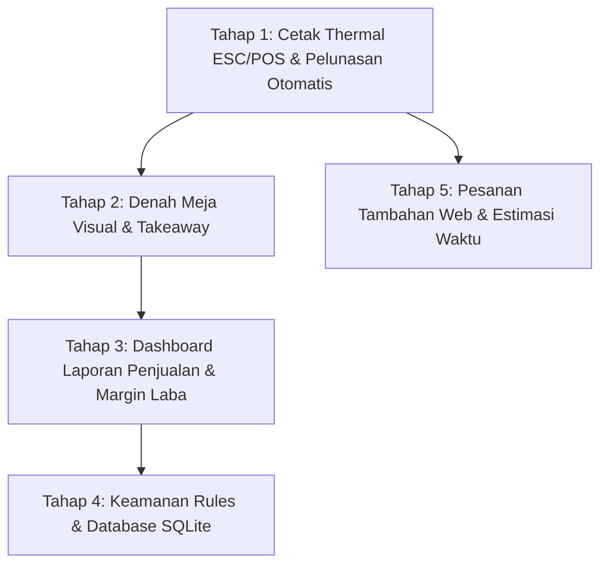

# Roadmap Rencana Pengembangan Ekosistem Mini Resto POS

Dokumen ini berisi peta jalan (*roadmap*) dan spesifikasi teknis lengkap untuk menyempurnakan aplikasi **Mini Resto POS (Flutter Kasir + Web Self-Ordering + Firebase Firestore)** agar siap digunakan secara andal pada operasional restoran sesungguhnya.

---

## Daftar Rencana Tahapan Pengembangan

| Tahap | Judul Dokumen | Fokus Utama | Estimasi Kompleksitas |
|:---:|---|---|:---:|
| **Audit Khusus** | [**Audit & Perbaikan Flow, UI, dan Logika Pembayaran**](file:///c:/Project/mini-resto-pos/plans/analisis_dan_perbaikan_flow_logika_pembayaran.md) | **[PRIORITAS UTAMA]** Audit 10 kasus inkonsistensi flow, bug cart collision kasir, tabrakan pembayaran round 2, verifikasi QRIS mandiri, dan pengetatan keamanan Firestore. | Kritis / Sangat Penting |
| **Tahap 1** | [**Tahap 1: Printer Thermal & Sinkronisasi Pelunasan**](file:///c:/Project/mini-resto-pos/plans/tahap_1_printer_thermal_dan_sinkronisasi_pelunasan.md) | Cetak struk kasir fisik & tiket koki dapur (KOT) via printer thermal Bluetooth/USB ESC/POS + Sinkronisasi instan pelunasan kasir ke layar HP tamu di meja. | Menengah |
| **Tahap 2** | [**Tahap 2: Denah Meja Visual (Visual Table Map)**](file:///c:/Project/mini-resto-pos/plans/tahap_2_denah_meja_visual.md) | Tampilan grid denah meja interaktif dengan indikator status warna (🟢 Kosong, 🔴 Terisi, 🟡 Pesanan Baru, 🔵 Panggil Pelayan) dan penanganan pesanan bungkus (*Takeaway*). | Menengah |
| **Tahap 3** | [**Tahap 3: Laporan Penjualan & Analitik Owner**](file:///c:/Project/mini-resto-pos/plans/tahap_3_laporan_penjualan_dan_analitik_owner.md) | Dashboard analitik bisnis pemilik resto: filter tanggal, rekap metode bayar, menu terlaris (*best seller*), margin laba kotor, dan ekspor ringkasan ke WhatsApp Owner. | Tinggi |
| **Tahap 4** | [**Tahap 4: Keamanan Firestore & Database Lokal Terstruktur**](file:///c:/Project/mini-resto-pos/plans/tahap_4_keamanan_firestore_dan_database_lokal.md) | Penguatan aturan keamanan Firestore (`firestore.rules`) anti-manipulasi data, migrasi penyimpanan lokal dari SharedPreferences ke SQLite (`sqflite`), serta pembersihan memori data lama. | Tinggi |
| **Tahap 5** | [**Tahap 5: Penyempurnaan Web Self-Ordering Meja**](file:///c:/Project/mini-resto-pos/plans/tahap_5_penyempurnaan_web_ordering.md) | Fitur pesanan tambahan (*Round 2 Order*) yang otomatis digabung ke open tab meja kasir, estimasi waktu dapur, badge rekomendasi/pedas, dan alert di HP tamu saat makanan diantar. | Menengah |

---

## Alur Implementasi yang Direkomendasikan

---

## Cara Menggunakan Panduan Ini
Setiap berkas rencana di dalam folder `plans/` ini telah disusun secara terperinci mencakup:
1. **Latar Belakang & Masalah yang Diselesaikan**
2. **Kebutuhan Dependensi & Library**
3. **Arsitektur Berkas yang Diubah / Dibuat**
4. **Alur Kerja Pengguna & Logika Bisnis**
5. **Rencana Pengujian (*Verification Plan*)**

Anda dapat memilih tahapan mana pun yang ingin dieksekusi terlebih dahulu sesuai prioritas kebutuhan operasional restoran Anda.
