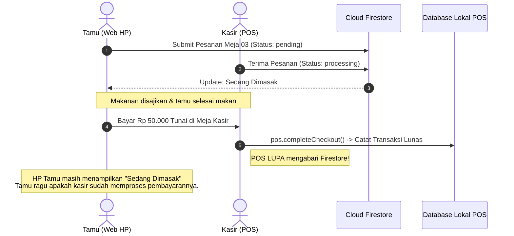

# Spesifikasi & Rencana Perbaikan: Inkonsistensi Flow, UI, dan Logika Pembayaran

Dokumen ini merangkum hasil audit teknis menyeluruh terhadap seluruh logika bisnis, antarmuka (UI/UX), dan alur pembayaran pada ekosistem **Mini Resto POS (Aplikasi Kasir Flutter + Web Self-Ordering + Firebase Firestore)**, beserta rencana aksi perbaikan bertahap lengkap dengan contoh kasus nyata di lapangan.

---

## 1. Ringkasan Eksekutif & Latar Belakang

Sistem Mini Resto POS dirancang dengan model **Hybrid Realtime**, menghubungkan kasir di meja pembayaran dengan tamu yang memesan mandiri via scan QR meja di ponsel mereka.

Namun, audit kode menemukan adanya **ketidaksinkronan status pembayaran (*status disconnect*)**, **penghapusan keranjang kasir mendadak (*cart state overwrite*)**, **pembayaran ganda/terlewat pada pesanan tambahan (*round 2*)**, serta **celah keamanan pada Firestore Rules**. Dokumen ini menjadi acuan tunggal untuk mengeksekusi perbaikan kode secara presisi dan aman.

---

## 2. Matriks Temuan Kasus & Dampak Operasional

| Kasus | Area & Berkas Terkait | Tingkat Keparahan | Dampak Finansial & Operasional |
|:---:|---|:---:|---|
| **Kasus 1** | **Sinkronisasi Pelunasan Kasir**<br>[`pos_screen.dart`](file:///c:/Project/mini-resto-pos/lib/views/screens/pos_screen.dart), [`pos_provider.dart`](file:///c:/Project/mini-resto-pos/lib/providers/pos_provider.dart), [`web_order/app.js`](file:///c:/Project/mini-resto-pos/web_order/app.js) | **KRITIS** | Kasir melunasi pesanan di POS, namun Firestore tidak diperbarui. Layar HP tamu gantung di status memasak / tidak tahu sudah lunas. |
| **Kasus 2** | **"Ghost Payment" QRIS Mandiri Web**<br>[`web_order/app.js`](file:///c:/Project/mini-resto-pos/web_order/app.js), [`online_order_model.dart`](file:///c:/Project/mini-resto-pos/lib/models/online_order_model.dart), [`open_tabs_screen.dart`](file:///c:/Project/mini-resto-pos/lib/views/screens/open_tabs_screen.dart) | **KRITIS** | Tamu scan QRIS & bayar di HP, tapi kasir tidak tahu karena kolom `paymentMethod` dan `paymentStatus` tidak diparsing di Flutter POS. Kasir menagih ulang. |
| **Kasus 3** | **Tabrakan Tagihan Multi-Round (Round 2)**<br>[`web_order/app.js`](file:///c:/Project/mini-resto-pos/web_order/app.js), [`pos_provider.dart`](file:///c:/Project/mini-resto-pos/lib/providers/pos_provider.dart) | **KRITIS** | Tamu bayar Round 1 via QRIS, lalu pesan Round 2 via kasir. Tagihan kasir menggabungkan semua menu tanpa memotong Round 1 yang sudah dibayar. |
| **Kasus 4** | **Cart Kasir Terhapus Otomatis**<br>[`online_order_provider.dart`](file:///c:/Project/mini-resto-pos/lib/providers/online_order_provider.dart), [`pos_provider.dart`](file:///c:/Project/mini-resto-pos/lib/providers/pos_provider.dart) | **TINGGI** | Kasir sedang input pesanan walk-in di kasir. Saat menekan "Terima & Buka Meja" pesanan online, keranjang aktif kasir terhapus total. |
| **Kasus 5** | **Celah Manipulasi Status Tamu**<br>[`firestore.rules`](file:///c:/Project/mini-resto-pos/firestore.rules) | **TINGGI** | Tamu nakal bisa mengeksekusi update Firestore langsung dari browser console untuk mengubah status pesanannya menjadi `paid` tanpa membayar. |
| **Kasus 6** | **Katalog Parsial Terkirim ke Web**<br>[`open_tabs_screen.dart`](file:///c:/Project/mini-resto-pos/lib/views/screens/open_tabs_screen.dart) | **SEDANG** | Tombol "Sinkronkan Menu ke Web" mengirim `posProvider.filteredProducts` (hanya menu yang sedang dicari kasir), bukan seluruh menu. |
| **Kasus 7** | **Inkonsistensi Format Meja**<br>[`online_order_provider.dart`](file:///c:/Project/mini-resto-pos/lib/providers/online_order_provider.dart), [`open_tabs_screen.dart`](file:///c:/Project/mini-resto-pos/lib/views/screens/open_tabs_screen.dart) | **SEDANG** | Format `"04"` vs `"Meja 04"` vs `"Meja 4"` vs `"Lesehan A"`. Pesanan Round 2 gagal digabung ke meja kasir karena string tidak identik. |
| **Kasus 8** | **Infinite Toggle Menu Habis**<br>[`products_screen.dart`](file:///c:/Project/mini-resto-pos/lib/views/screens/products_screen.dart) | **SEDANG** | Tombol toggle awan selalu bernilai `false` (HABIS) jika produk tidak melacak stok, dan tidak bisa dikembalikan ke TERSEDIA. |
| **Kasus 9** | **Pengurangan Qty Web Menghapus Catatan**<br>[`web_order/app.js`](file:///c:/Project/mini-resto-pos/web_order/app.js) | **RENDAH** | Menekan tombol minus pada menu utama menghapus varian yang memiliki kustomisasi rasa/catatan khusus terlebih dahulu. |
| **Kasus 10** | **Sesi Tamu Lama Tertinggal**<br>[`web_order/app.js`](file:///c:/Project/mini-resto-pos/web_order/app.js) | **SEDANG** | Tamu baru yang duduk di meja yang sama melihat data pesanan tamu sebelumnya karena LocalStorage tidak dibersihkan saat transaksi selesai. |

---

## 3. Rincian Kasus Nyata & Logika Kegagalan Sistem

### Kasus 1: Putusnya Rantai Sinkronisasi Pelunasan Kasir ke Layar HP Tamu

* **Solusi Teknis:**
  Setelah `completeCheckout()` berhasil, panggil `CloudSyncService.updateOrderStatus(orderId, 'paid')` dan `updatePaymentStatus(orderId, 'paid')`. Pada web tamu, dengarkan status `paid` dan tampilkan modal *Receipt Digital Lunas* sebelum membersihkan sesi.

---

### Kasus 2: "Ghost Payment" QRIS Mandiri di Web Tamu
* **Skenario Nyata:**
  Tamu memesan via HP dan memilih opsi *"Bayar Sekarang via QRIS"*. Tamu memindai QR dinamis dan saldo rekeningnya terpotong Rp 38.000. Tamu menekan tombol *"Saya Sudah Bayar"*.
* **Akar Masalah:**
  1. Tombol *"Saya Sudah Bayar"* di web hanya menutup modal QRIS secara lokal, **tidak memperbarui status dokumen pesanan di Firestore**.
  2. Model data [`OnlineOrderModel`](file:///c:/Project/mini-resto-pos/lib/models/online_order_model.dart) di Flutter mengabaikan kolom `paymentMethod` dan `paymentStatus`.
  3. Layar kasir tidak menampilkan badge penanda apapun. Kasir mengira pesanan belum dibayar dan menagih ulang ke tamu saat mau pulang.
* **Solusi Teknis:**
  1. Tombol *"Saya Sudah Bayar"* di web wajib mengupdate Firestore: `paymentStatus: 'waiting_verification'`.
  2. Model Flutter memparsing `paymentMethod` dan `paymentStatus`.
  3. Kartu pesanan di `OpenTabsScreen` menampilkan badge mencolok:
     * 🟡 `MENUNGGU VERIFIKASI QRIS (HP TAMU)` + tombol *"Verifikasi & Terima Dana"*
     * 🟢 `LUNAS VIA QRIS`

---

### Kasus 3: Tabrakan Pembayaran Pesanan Tambahan (Multi-Round)
* **Skenario Nyata:**
  * Ronde 1: Tamu memesan Makanan Utama (Rp 40.000) dan membayar langsung via QRIS di HP.
  * Ronde 2: Tamu memesan Es Jeruk (Rp 12.000) dan memilih bayar di kasir saat selesai makan.
* **Akar Masalah:**
  Saat Ronde 2 digabungkan ke Open Tab kasir melalui `appendItemsToOpenTab()`, total Open Tab menjadi Rp 52.000 tanpa memisahkan bahwa Rp 40.000 sudah lunas. Kasir menagih Rp 52.000 penuh ke tamu.
* **Solusi Teknis:**
  Tambahkan field `paidAmount` dan `remainingAmount` pada [`OrderModel`](file:///c:/Project/mini-resto-pos/lib/models/order_model.dart). Jika suatu ronde sudah dibayar via QRIS di web, nominal tersebut langsung dicatat sebagai `paidAmount` di Open Tab kasir, sehingga kasir hanya menagih sisa kekurangannya (Rp 12.000).

---

### Kasus 4: Bug Cart Overwrite Kasir saat Menerima Pesanan Online
* **Skenario Nyata:**
  Kasir sedang melayani tamu *dine-in* di depan konter kasir dan telah memasukkan 4 item ke keranjang. Tiba-tiba ada notifikasi pesanan online masuk dari Meja 05. Kasir mengklik tombol *"Terima & Buka Meja"*.
* **Akar Masalah:**
  Fungsi `acceptOrder()` di `OnlineOrderProvider` memanggil `posProvider.clearCart()`, `posProvider.setTableNo()`, lalu memasukkan item pesanan online ke keranjang aktif kasir sebelum memanggil `saveAsOpenTab()`. Keranjang transaksi pelanggan di depan kasir langsung terhapus seketika!
* **Solusi Teknis:**
  Tambahkan fungsi mandiri `createOpenTabDirectly()` pada `PosProvider` yang langsung menulis ke database lokal tanpa memanipulasi `_cartItems` aktif kasir.

---

### Kasus 5: Celah Keamanan Firestore Rules
* **Akar Masalah:**
  Di `firestore.rules`:
  ```javascript
  allow update: if request.auth != null
                || (request.resource.data.diff(resource.data).affectedKeys().hasAny(['status', 'paymentStatus', 'updatedAt'])
                    && request.resource.data.totalAmount == resource.data.totalAmount);
  ```
  Aturan ini memungkinkan tamu tanpa autentikasi mengubah `status` menjadi `paid` atau `completed` sesuka hati.
* **Solusi Teknis:**
  Batasi agar pengguna tanpa auth (`request.auth == null`) **hanya boleh** mengupdate `paymentStatus` ke `'waiting_verification'`. Status `'paid'`, `'processing'`, `'completed'`, dan `'rejected'` **hanya boleh ditulis oleh Kasir berautentikasi (`request.auth != null`)**.

---

## 4. Arsitektur Perubahan Berkas

```mermaid
graph LR
    subgraph "Web Tamu (web_order)"
        JS["app.js"] -->|1. Kirim paymentStatus: waiting_verification| FS[("Cloud Firestore")]
        JS -->|2. Tampilkan Struk Lunas saat status: paid| UI_WEB["UI Struk Digital"]
    end

    subgraph "Cloud Security"
        FS --> RULES["firestore.rules (Perketat Auth)"]
    end

    subgraph "Kasir POS (Flutter)"
        FS --> CS["CloudSyncService"]
        CS --> OOM["OnlineOrderModel (+payment fields)"]
        OOM --> OOP["OnlineOrderProvider"]
        OOP -->|createOpenTabDirectly (Tanpa wipe cart)| POS["PosProvider"]
        POS --> OM["OrderModel (+paidAmount)"]
        POS_SCREEN["pos_screen: completeCheckout()"] -->|Update status: paid| CS
        OPEN_TABS["open_tabs_screen"] -->|Tampilkan Badge Verifikasi QRIS| UI_POS["UI Kasir"]
    end
```

---

## 5. Rencana Eksekusi Perbaikan Kode Langkah demi Langkah

### Langkah 1: Pembaruan Model Data Flutter [SELESAI]
- [x] **[`lib/models/online_order_model.dart`](file:///c:/Project/mini-resto-pos/lib/models/online_order_model.dart)**:
  - Ditambahkan field:
    ```dart
    final String paymentMethod; // 'cashier' | 'qris'
    final String paymentStatus; // 'unpaid' | 'waiting_verification' | 'paid'
    ```
  - Diperbarui `toMap()`, `fromMap()`, `fromFirestoreRest()`, status `paid`, dan helper getter (`isPaid`, `isQrisWaitingVerification`, `isQrisPaid`).
- [x] **[`lib/models/order_model.dart`](file:///c:/Project/mini-resto-pos/lib/models/order_model.dart)**:
  - Ditambahkan field `paidAmount` dan `onlineOrderId`.
  - Ditambahkan getter `int get remainingAmount => (total - paidAmount).clamp(0, 999999999);`.

### Langkah 2: Perbaikan State Management di Kasir [SELESAI]
- [x] **[`lib/providers/pos_provider.dart`](file:///c:/Project/mini-resto-pos/lib/providers/pos_provider.dart)**:
  - Ditambahkan metode `createOpenTabDirectly()` untuk membuat Open Tab baru tanpa menghapus/menyentuh keranjang aktif kasir (`_cartItems`).
  - Diperbarui `appendItemsToOpenTab()` dengan normalisasi meja (`_normalizeTable`) dan akumulasi `paidAmount` & `onlineOrderId`.
- [x] **[`lib/providers/online_order_provider.dart`](file:///c:/Project/mini-resto-pos/lib/providers/online_order_provider.dart)**:
  - Dimodifikasi `acceptOrder()` menggunakan `createOpenTabDirectly()` (bebas bug cart collision).
  - Ditambahkan fungsi `verifyQrisPayment(orderId)` untuk memvalidasi pembayaran QRIS web tamu.
  - Ditambahkan fungsi `markTableOrderPaid(...)` dan pemantauan realtime ketersediaan produk cloud `_cloudProductAvailability`.
- [x] **[`lib/services/cloud_sync_service.dart`](file:///c:/Project/mini-resto-pos/lib/services/cloud_sync_service.dart)**:
  - Ditambahkan fungsi update status pelunasan Firestore:
    ```dart
    Future<bool> markOrderAsPaid(String orderId, String paymentMethod)
    Future<bool> updatePaymentStatus(String orderId, String paymentStatus)
    ```

### Langkah 3: Integrasi Antarmuka Kasir [SELESAI]
- [x] **[`lib/views/screens/open_tabs_screen.dart`](file:///c:/Project/mini-resto-pos/lib/views/screens/open_tabs_screen.dart)**:
  - Ditambahkan badge visual interaktif untuk pesanan yang meminta verifikasi QRIS mandiri (`⚠️ CEK MUTASI QRIS (HP TAMU)` & tombol *Verifikasi Dana*).
  - Diperbaiki pemanggilan sinkronisasi menu dari seluruh katalog (`posProvider.products`), bukan terpotong oleh search query aktif.
  - Diperbaiki pencocokan nomor meja agar mendukung penamaan meja alfanumerik (misal: "Lesehan A", "VIP 2").
- [x] **[`lib/views/screens/pos_screen.dart`](file:///c:/Project/mini-resto-pos/lib/views/screens/pos_screen.dart)**:
  - Pada `_openPaymentDialog`, nominal tagihan dipotong otomatis dengan uang muka `paidAmount` agar pesanan round 2 tidak menagih ulang round 1 yang sudah dibayar di muka.
  - Setelah `pos.completeCheckout()` berhasil, memanggil `onlineOrderProvider.markTableOrderPaid()` untuk mengabari Cloud Firestore secara otomatis.
- [x] **[`lib/views/screens/products_screen.dart`](file:///c:/Project/mini-resto-pos/lib/views/screens/products_screen.dart)**:
  - Diperbaiki tombol toggle ketersediaan menu di cloud agar membaca status aktual dan beroperasi dua arah (tersedia <-> habis).

### Langkah 4: Penyempurnaan Web Self-Ordering (`web_order`) [SELESAI]
- [x] **[`web_order/index.html`](file:///c:/Project/mini-resto-pos/web_order/index.html) & [`web_order/styles.css`](file:///c:/Project/mini-resto-pos/web_order/styles.css)**:
  - Ditambahkan modal struk digital pembayaran lunas (`paymentSuccessModal`) dengan animasi checkmark hijau, rincian pembayaran, dan tombol *"Selesai & Kosongkan Meja"*.
- [x] **[`web_order/app.js`](file:///c:/Project/mini-resto-pos/web_order/app.js)**:
  - Ketika tamu menekan *"Saya Sudah Bayar"* pada modal QRIS, sistem mengirim patch ke Firestore: `{ paymentStatus: 'waiting_verification', updatedAt: ... }`.
  - Pada listener status pesanan: ketika status berubah menjadi `'paid'`, sistem menampilkan modal struk pembayaran digital lunas (`showPaymentSuccessReceipt`), bukan menghapus sesi diam-diam.
  - Diperbaiki fungsi `updateQty` agar memprioritaskan pengurangan item tanpa catatan saat tombol minus ditekan di beranda menu.
  - Ditambahkan deteksi dan pembersihan otomatis sesi usang (> 4 jam) pada `loadTableState()`.

### Langkah 5: Pengetatan Aturan Keamanan Firestore [SELESAI]
- [x] **[`firestore.rules`](file:///c:/Project/mini-resto-pos/firestore.rules)**:
  - Mengunci hak update status pesanan dan pelunasan hanya untuk kasir terautentikasi (`request.auth != null`).
  - Tamu web tanpa login (`request.auth == null`) HANYA diizinkan mengupdate `paymentStatus == 'waiting_verification'` dan `updatedAt`.


---

## 6. Rencana Pengujian & Verifikasi (*Verification Plan*)

1. **Uji Kasus Cart Kasir Tidak Hilang**:
   - Buka kasir POS -> Masukkan 3 menu sembarang ke keranjang kasir (jangan checkout).
   - Buat pesanan baru dari web browser `http://localhost:8080/?table=04`.
   - Di aplikasi kasir, buka Open Tabs -> Klik "Terima & Buka Meja".
   - Beralih kembali ke Kasir POS -> **Verifikasi: 3 menu awal kasir masih utuh dan tidak terhapus**.

2. **Uji Alur Pelunasan Meja Realtime**:
   - Pesan menu dari web meja 04.
   - Kasir menerima dan membuka meja di kasir POS.
   - Kasir melunasi meja tersebut via dialog pembayaran kasir (Tunai / QRIS).
   - **Verifikasi: Dalam 1–2 detik, layar HP tamu otomatis beralih menampilkan pesan "Pembayaran Lunas! Terima kasih atas kunjungan Anda"**.

3. **Uji Verifikasi QRIS Mandiri Web**:
   - Tamu memilih "Bayar Sekarang via QRIS" di web.
   - Tamu klik "Saya Sudah Bayar".
   - **Verifikasi di Kasir**: Pada tab pesanan online kasir, muncul badge kuning *"⚠️ CEK MUTASI QRIS"* beserta nominal yang harus dicek kasir.

4. **Uji Penolakan Tamu Liar di Firestore**:
   - Jalankan script konsol web: `db.collection('table_orders').doc('ORD-XXX').update({ status: 'completed' })`.
   - **Verifikasi**: Firestore menolak request dengan status `PERMISSION_DENIED`.
