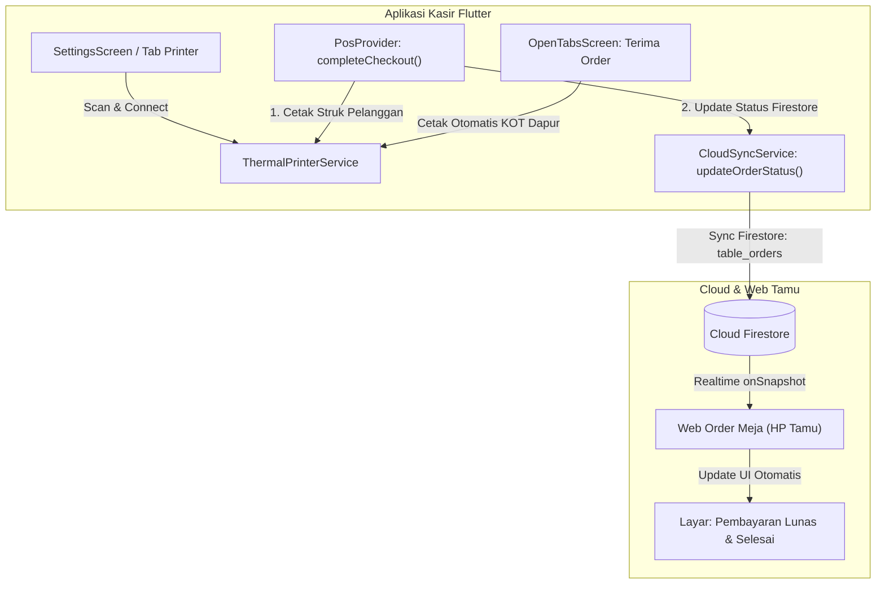

# Rencana Teknis Tahap 1: Integrasi Printer Thermal & Sinkronisasi Pelunasan

Dokumen ini merinci rencana teknis untuk mengimplementasikan pencetakan struk kasir fisik & tiket koki dapur (KOT) menggunakan printer thermal Bluetooth/USB, serta sinkronisasi instan status pelunasan transaksi dari kasir ke layar HP pelanggan.

---

## 1. Latar Belakang & Kebutuhan Operasional

1. **Kendala Saat Ini:**
   - Fitur cetak nota dan tiket dapur saat ini baru menghasilkan teks di layar atau dialog simulasi. Koki di dapur dan kasir di laci uang membutuhkan struk kertas fisik ukuran 58mm atau 80mm.
   - Ketika kasir melunasi pesanan meja yang dipesan tamu secara online, status hanya tersimpan di memori kasir. Tamu di meja tidak melihat konfirmasi pelunasan pada pelacak pesanannya di HP.
2. **Hasil yang Ingin Dicapai:**
   - Kasir dapat menghubungkan printer thermal Bluetooth/USB (misalnya printer Panda, Sunmi, Imin, E-Print, Xprinter, dsb.).
   - Struk kasir pelanggan dan tiket dapur (KOT) dapat dicetak langsung secara otomatis maupun manual.
   - Pelunasan pesanan di POS kasir seketika mengubah status pesanan online di Firestore menjadi `completed`, sehingga HP pelanggan di meja menampilkan pesan ramah: *"Pembayaran Selesai! Terima kasih telah bersantap di Resto Digital."*

---

## 2. Arsitektur Komponen & Berkas yang Terlibat



### Rincian Berkas yang Dibuat / Diperbarui:

1. [`lib/services/thermal_printer_service.dart`](file:///c:/Project/mini-resto-pos/lib/services/thermal_printer_service.dart) **[BARU]**:
   - Menangani pemindaian perangkat Bluetooth (*Scan Devices*), pemasangan koneksi (*Connect/Disconnect*), dan pembuatan byte ESC/POS untuk teks, garis, format tabel item, serta potong kertas (*Paper Cut*).
   - Mendukung format 58mm (32 karakter/baris) dan 80mm (48 karakter/baris).
2. [`lib/providers/printer_provider.dart`](file:///c:/Project/mini-resto-pos/lib/providers/printer_provider.dart) **[BARU]**:
   - Menyimpan status koneksi printer aktif (nama printer, MAC address bluetooth), ukuran kertas terpilih, dan saklar cetak otomatis dapur (*Auto-print KOT on Accept*).
3. [`lib/views/screens/settings_screen.dart`](file:///c:/Project/mini-resto-pos/lib/views/screens/settings_screen.dart) **[MODIFIKASI]**:
   - Menambahkan tab baru / kartu pengaturan **"Printer Thermal"**: tombol cari printer bluetooth, status terhubung, pemilihan lebar kertas (58mm/80mm), dan tombol **"Uji Cetak Struk Contoh"**.
4. [`lib/views/screens/pos_screen.dart`](file:///c:/Project/mini-resto-pos/lib/views/screens/pos_screen.dart) **[MODIFIKASI]**:
   - Pada alur `_openPaymentDialog`, setelah pembayaran dikonfirmasi, panggil `printerProvider.printReceipt(transaction, order)` dan update status pesanan online jika berasal dari meja tamu.
5. [`lib/views/screens/open_tabs_screen.dart`](file:///c:/Project/mini-resto-pos/lib/views/screens/open_tabs_screen.dart) **[MODIFIKASI]**:
   - Tombol "Cetak Tiket KOT" langsung mengirim byte cetak ke printer koki dapur.
   - Saat kasir menekan tombol "Terima & Proses", jika opsi cetak otomatis aktif, tiket KOT langsung keluar dari printer dapur tanpa perlu klik manual.
6. [`web_order/app.js`](file:///c:/Project/mini-resto-pos/web_order/app.js) **[MODIFIKASI]**:
   - Memperbarui listener pelacak pesanan (`listenOrderTracker`) agar ketika `order.status === 'completed'`, tampilan modal beralih ke ucapan terima kasih dengan ringkasan pembayaran dan tombol selesai.

---

## 3. Desain Format Struk Thermal (ESC/POS Layout)

### Format Struk Pembayaran Kasir (58mm):
```text
================================
         RESTO DIGITAL
     Jl. Pemuda No. 29, Jaktim
        WA: 0812-3456-7890
================================
No. Nota : TRX-269663
Waktu    : 12/09/2026 17:30
Kasir    : Ipank (Owner)
Meja     : Meja 03
Pemesan  : Jon
--------------------------------
1x Nasi Goreng Spesial  28.000
   *Pedas Sedang
1x Es Teh Manis          6.000
   *Es Sedikit
--------------------------------
Subtotal:              Rp 34.000
Diskon:                    Rp  0
--------------------------------
TOTAL AKHIR:           Rp 34.000
Metode Bayar:          QRIS AUTO
Status:                LUNAS
================================
  Terima kasih atas kunjungannya!
      Selamat menikmati hidangan
================================
```

### Format Tiket Dapur / KOT (58mm):
```text
================================
      TIKET PESANAN DAPUR
            [ KOT ]
================================
MEJA     : MEJA 03
PEMESAN  : JON
WAKTU    : 17:30
ORDER ID : ORD-269663
--------------------------------
[1]  NASI GORENG SPESIAL RESTO
     >> [PEDAS SEDANG, TELUR 1/2]

[1]  ES TEH MANIS
     >> [ES SEDIKIT]
--------------------------------
TOTAL: 2 PORSI / ITEM
================================
```

---

## 4. Rencana Dependensi yang Dibutuhkan
Tambahkan pada `pubspec.yaml`:
```yaml
dependencies:
  esc_pos_utils_plus: ^2.0.4    # Generator byte ESC/POS standar
  print_bluetooth_thermal: ^1.1.2 # Menghubungkan perangkat printer Bluetooth Android/Windows
```

---

## 5. Rencana Pengujian & Verifikasi (*Verification Plan*)

1. **Uji Driver & Emulator Thermal**:
   - Memastikan byte ESC/POS dapat dibuat tanpa eror menggunakan unit test.
   - Uji coba tombol "Test Print" menghasilkan format nota rapi tanpa pemotongan kata acak (*no wrapped word cuts*).
2. **Uji Alur Cetak KOT Otomatis**:
   - Simulasi pesanan masuk dari Meja 03 -> Kasir klik "Terima & Proses" -> Printer dapur otomatis mencetak tiket KOT.
3. **Uji Sinkronisasi Pelunasan**:
   - Buka `http://localhost:8080/?table=03` di browser.
   - Kirim pesanan baru.
   - Di aplikasi kasir, buka pesanan tersebut lalu lunasi via Tunai/QRIS.
   - Verifikasi: Dalam 1–2 detik, layar HP tamu otomatis beralih menampilkan banner hijau *"Pembayaran Lunas! Terima kasih telah berkunjung"*.
