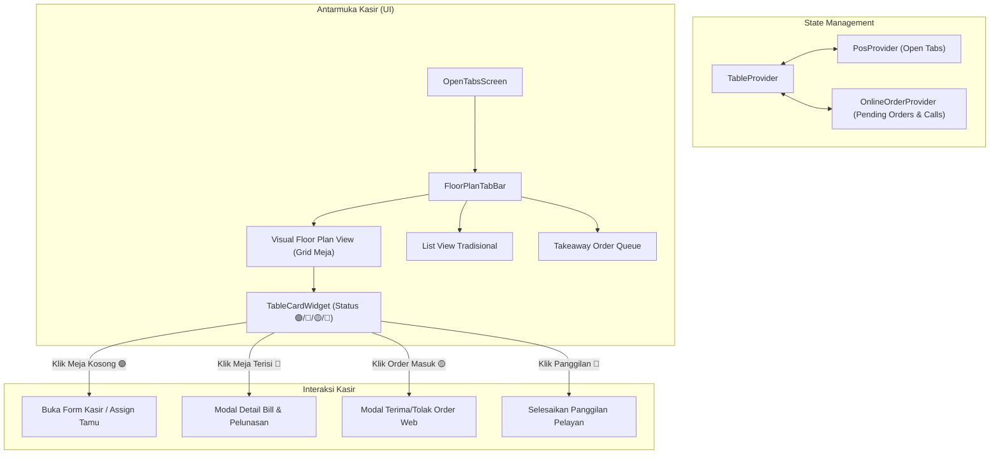

# Rencana Teknis Tahap 2: Denah Meja Visual (Visual Table Map) & Manajemen Takeaway

Dokumen ini merinci rancangan teknis untuk mengimplementasikan antarmuka denah meja visual interaktif (*Visual Floor Plan*) dengan indikator status warna real-time, serta sistem pemisahan pesanan bungkus (*Takeaway / To-Go*).

---

## 1. Latar Belakang & Kebutuhan Operasional

1. **Kendala Saat Ini:**
   - Layar tab pesanan terbuka ([`open_tabs_screen.dart`](file:///c:/Project/mini-resto-pos/lib/views/screens/open_tabs_screen.dart)) saat ini hanya menampilkan daftar kartu sederhana dari meja yang sedang memiliki pesanan aktif.
   - Kasir dan pelayan kesulitan melihat meja fisik mana saja yang kosong (*tersedia*), meja mana yang sudah selesai makan, meja mana yang baru saja mengirim pesanan web, dan meja mana yang sedang memencet tombol panggil pelayan.
   - Pesanan bawa pulang (*Takeaway / Bungkus*) saat ini masih tercampur dalam alur nomor meja biasa, sehingga menyulitkan koki dapur dan kasir dalam membedakan kemasan bungkusan.

2. **Hasil yang Ingin Dicapai:**
   - Visualisasi denah tata letak meja restoran (*Grid Floor Plan*) yang responsif di tablet dan desktop kasir.
   - Warna status meja real-time yang jelas dan intuitif:
     - 🟢 **Hijau (Kosong/Tersedia):** Siap ditempati tamu baru.
     - 🔴 **Merah (Terisi/Sedang Makan):** Ada pesanan aktif, menampilkan durasi makan dan nominal bill berjalan.
     - 🟡 **Kuning (Order Web Baru):** Tamu di meja baru saja checkout via HP, butuh konfirmasi kasir.
     - 🔵 **Biru (Panggilan Pelayan Aktif):** Tamu menekan tombol "Panggil Pelayan" di web.
   - Panel khusus **"Takeaway / Bungkus"** terpisah dengan penomoran otomatis `TA-01`, `TA-02`, dll.
   - Fitur pengaturan meja & area (Indoor, Outdoor, VIP) di menu Pengaturan.

---

## 2. Arsitektur Komponen & Aliran Data

---

## 3. Rincian Berkas yang Dibuat / Diperbarui

### 1. [`lib/models/restaurant_table.dart`](file:///c:/Project/mini-resto-pos/lib/models/restaurant_table.dart) **[SELESAI - BARU]**
- [x] Model data `RestaurantTable` dengan atribut `id`, `tableNumber`, `section`, `capacity`, `isActive`.
- [x] Helper normalisasi alfanumerik `normalize()` dan `isMatch()`.
- [x] Enum `TableStatus` (`available`, `occupied`, `pendingWebOrder`, `callingWaiter`).
- [x] Generator meja default `getDefaultTables()`.

### 2. [`lib/views/widgets/table_floor_card.dart`](file:///c:/Project/mini-resto-pos/lib/views/widgets/table_floor_card.dart) **[SELESAI - BARU]**
- [x] Widget kartu meja responsif multi-resolusi (HP Android Portrait, Tablet, Desktop).
- [x] Indikator status warna real-time (🟢 Kosong, 🔴 Terisi, 🟡 Order Baru, 🔔 Panggil Pelayan).
- [x] Tampilan ringkasan tamu, durasi duduk, jumlah item, total tagihan, dan badge pembayaran.

### 3. [`lib/views/widgets/table_action_sheet.dart`](file:///c:/Project/mini-resto-pos/lib/views/widgets/table_action_sheet.dart) **[SELESAI - BARU]**
- [x] Modal aksi meja adaptif: Modal Bottom Sheet pada HP Android Portrait (< 600px), Centered Dialog pada Tablet/Desktop (>= 600px).
- [x] Aksi Meja Kosong: Buka transaksi baru langsung dengan nomor meja terpasang di POS kasir.
- [x] Aksi Meja Terisi: Rincian pesanan, buka di kasir/bayar, cetak KOT dapur, dan pindah meja.
- [x] Aksi Order Masuk: Rincian item, terima pesanan & cetak KOT, tolak pesanan, verifikasi dana QRIS.
- [x] Selesaikan panggilan pelayan dengan satu sentuhan.

### 4. [`lib/views/screens/open_tabs_screen.dart`](file:///c:/Project/mini-resto-pos/lib/views/screens/open_tabs_screen.dart) **[SELESAI - DIMODIFIKASI]**
- [x] Mengganti 2-tab lama dengan Single View Denah Meja Visual Terpadu.
- [x] Dukungan Multi-Resolusi via `LayoutBuilder`: 2 kolom di HP Portrait (< 500px), 3-4 kolom di Tablet, 5-6 kolom di Desktop.
- [x] Filter Chips horizontal: `Semua`, `🟢 Kosong`, `🔴 Terisi`, `🟡 Order Baru`, `🥡 Takeaway`.
- [x] Dialog pengaturan cepat jumlah meja resto via SharedPreferences.
- [x] Dukungan pemisahan pesanan bungkus (Takeaway).

### 5. [`lib/providers/pos_provider.dart`](file:///c:/Project/mini-resto-pos/lib/providers/pos_provider.dart) **[SELESAI - DIMODIFIKASI]**
- [x] Ditambahkan metode `moveTable(currentTable, newTable)` untuk memindahkan pesanan meja aktif.

---

## 4. Spesifikasi UI & State Indikator Meja

| Status Meja | Warna Akses & Badge | Deskripsi Kondisi | Aksi Saat Kartu Diklik |
|---|---|---|---|
| **Kosong (Available)** | 🟢 Aksen Hijau Emerald (`#10B981`) | Meja tidak ada order aktif, tidak ada panggilan, dan tidak ada tamu. | Buka layar POS Kasir langsung dengan nomor meja tersebut terisi otomatis. |
| **Terisi (Occupied)** | 🔴 Aksen Merah Crimson (`#EF4444`) | Tamu sedang bersantap, ada pesanan aktif di sistem. | Buka modal rincian bill, opsi tambah pesanan meja, atau tombol cetak pre-bill & pelunasan. |
| **Order Baru (Pending Web)** | 🟡 Aksen Kuning Amber (`#F59E0B`) *(Pulse Glow)* | Tamu meja memesan lewat web QR, status belum diterima kasir. | Langsung membuka modal pratinjau pesanan untuk tombol *Terima & Proses KOT* atau *Tolak*. |
| **Panggil Pelayan** | 🔵 Aksen Biru Safir (`#3B82F6`) *(Bell Icon Flash)* | Tamu menekan tombol "Panggil Pelayan" di web meja. | Memunculkan alert cepat "Meja X membutuhkan pelayan" dan tombol "Konfirmasi Pelayanan Selesai". |

---

## 5. Alur Pemindahan Meja (Move Table) & Gabung Meja (Merge Bill)

1. **Pindah Meja (Move Table):**
   - Tamu di Meja 02 ingin pindah ke Meja 07 karena meja 07 lebih sejuk / meja sofa.
   - Kasir menahan (*long-press*) kartu Meja 02 atau menekan ikon *Pindah Meja*.
   - Sistem menampilkan daftar meja kosong yang tersedia.
   - Kasir memilih Meja 07 -> PosProvider mengalihkan seluruh pesanan aktif dan status web order ke Meja 07.
   - Meja 02 kembali berstatus Hijau (Kosong).

2. **Gabung Meja (Merge Bill):**
   - Tamu rombongan di Meja 04 dan Meja 05 ingin membayar satu struk bersama.
   - Kasir memilih opsi *Gabung Meja* -> Item belanjaan Meja 05 digabung ke dalam Meja 04.
   - Meja 05 dikosongkan secara otomatis.

---

## 6. Rencana Pengujian & Verifikasi (Verification Plan)

### A. Pengujian Fungsional & State:
1. **Simulasi Meja Kosong -> Terisi:**
   - Buat transaksi baru untuk Meja 01 di POS Kasir -> Periksa kartu Meja 01 langsung berubah dari hijau ke merah.
2. **Simulasi Web Order:**
   - Dari browser web order (`localhost:8080/?table=03`), kirim pesanan baru -> Verifikasi kartu Meja 03 di kasir seketika berubah warna kuning dengan efek animasi pulse.
   - Kasir menekan "Terima" -> Kartu berubah menjadi merah (terisi).
3. **Simulasi Panggilan Pelayan:**
   - Dari browser web order, klik "Panggil Pelayan" -> Kartu Meja 03 memunculkan ikon bel biru berkedip.
   - Kasir klik "Selesaikan" -> Status panggilan hilang.
4. **Simulasi Takeaway:**
   - Buat pesanan baru dengan memilih tipe "Takeaway" -> Verifikasi masuk ke tab Takeaway dengan kode `TA-xx`, tidak mengambil slot meja fisik.

### B. Pengujian Responsivitas UI:
- Uji tampilan pada resolusi tablet (landscape 1024x768 atau 1280x800) dan desktop (1920x1080) untuk memastikan denah meja tersusun rapi tanpa ada komponen yang terpotong (*overflow*).
