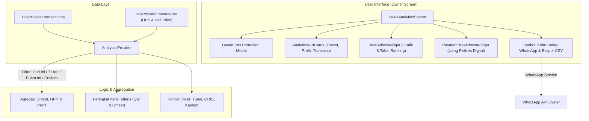

# Rencana Teknis Tahap 3: Dashboard Laporan Penjualan & Analitik Bisnis Owner

Dokumen ini merinci spesifikasi teknis untuk membangun sistem pelaporan penjualan komprehensif, analitik performa menu restoran, perhitungan margin laba kotor (*Gross Profit Margin*), serta fitur tutup kas harian (*End of Day Closing Report*) yang terkirim otomatis ke WhatsApp pemilik resto.

---

## 1. Latar Belakang & Kebutuhan Bisnis

1. **Kendala Saat Ini:**
   - Aplikasi kasir saat ini baru memiliki riwayat transaksi sederhana ([`transaction_history_screen.dart`](file:///c:/Project/mini-resto-pos/lib/views/screens/transaction_history_screen.dart)) tanpa agregasi statistik keuangan.
   - Pemilik restoran (*Owner*) tidak dapat memantau dengan cepat:
     - Berapa total omzet hari ini, minggu ini, atau bulan ini.
     - Berapa estimasi keuntungan bersih/kotor (*Gross Profit*) berdasarkan harga beli bahan/modal (HPP) vs harga jual.
     - Menu apa yang menjadi *Best Seller* dan menu apa yang kurang laku (*Slow Moving*).
     - Pembagian porsi metode pembayaran (Uang Tunai di laci kasir vs QRIS masuk rekening vs Kasbon).
   - Kasir masih harus menghitung uang fisik dan merekap secara manual di buku saat pergantian shift atau tutup toko di malam hari.

2. **Hasil yang Ingin Dicapai:**
   - Layar Dashboard Analitik khusus yang dilindungi PIN Keamanan Owner.
   - Ringkasan Kartu Metrik Utama (KPI): Total Omzet, Total Transaksi, Rata-rata Belanja Meja (*Average Order Value*), dan Estimasi Laba Kotor.
   - Grafik interaktif & tabel peringkat menu terlaris.
   - Rekap metode pembayaran untuk mencocokkan fisik uang tunai di laci kasir (*Cash Drawer Balance*).
   - Fitur **"Kirim Laporan Tutup Kasir (EOD) ke WhatsApp Owner"** hanya dengan satu klik.
   - Ekspor rekap transaksi ke format berkas **CSV / Excel**.

---

## 2. Arsitektur Komponen & Aliran Data



---

## 3. Rincian Berkas yang Dibuat / Diperbarui

### 1. [`lib/models/sales_analytics_model.dart`](file:///c:/Project/mini-resto-pos/lib/models/sales_analytics_model.dart) **[BARU]**
Struktur data model untuk ringkasan metrik analitik:
```dart
class SalesSummary {
  final DateTime startDate;
  final DateTime endDate;
  final double totalRevenue;       // Total omzet bruto
  final double totalDiscount;      // Total diskon yang diberikan
  final double netRevenue;         // Total omzet bersih
  final double totalCogs;          // Total HPP (Harga Pokok Penjualan)
  final double grossProfit;        // Laba kotor (netRevenue - totalCogs)
  final double profitMargin;       // Persentase margin laba (%)
  final int transactionCount;      // Jumlah struk transaksi
  final double averageOrderValue;  // Rata-rata nilai per transaksi (AOV)

  final Map<PaymentMethod, double> paymentBreakdown; // Tunai, QRIS, dll
  final List<ItemSalesRank> topSellingItems;         // Peringkat menu
}

class ItemSalesRank {
  final String menuItemId;
  final String itemName;
  final String category;
  final int totalQtySold;
  final double totalRevenue;
  final double totalProfit;
}
```

### 2. [`lib/providers/analytics_provider.dart`](file:///c:/Project/mini-resto-pos/lib/providers/analytics_provider.dart) **[BARU]**
Provider untuk memproses agregasi data transaksi:
- Memfilter transaksi berdasarkan rentang waktu terpilih (*Hari Ini, Kemarin, 7 Hari Terakhir, Bulan Berjalan, Rentang Tanggal Custom*).
- Menghitung HPP per item pesanan berdasarkan field `buyPrice` pada model menu.
- Menghitung uang fisik tunai yang wajib ada di laci kasir vs saldo QRIS digital.
- Menghasilkan ringkasan teks formal untuk laporan penutupan shift ke WhatsApp Owner.

### 3. [`lib/views/screens/sales_analytics_screen.dart`](file:///c:/Project/mini-resto-pos/lib/views/screens/sales_analytics_screen.dart) **[BARU]**
Layar dashboard komprehensif bagi pemilik resto:
- Bar atas: Pemilih rentang tanggal (*Date Range Picker*) & tombol filter cepat (*Chips*).
- Baris 1: Empat Kartu Metrik KPI:
  1. 💰 **Total Omzet Bersih**
  2. 📈 **Estimasi Laba Kotor & Margin %**
  3. 🧾 **Jumlah Transaksi & Rata-rata Belanja Meja (AOV)**
  4. 💵 **Total Kas Tunai di Laci**
- Baris 2: Grafik & Tabel **Menu Terlaris (Best Seller Ranking)** beserta persentase kontribusi omzet.
- Baris 3: Diagram **Metode Pembayaran** (Tunai, QRIS, Kasbon) untuk audit kasir.
- Tombol Aksi: **"Kirim Laporan Tutup Kasir ke WA Owner"** & **"Ekspor Laporan CSV"**.

### 4. [`lib/views/widgets/app_sidebar.dart`](file:///c:/Project/mini-resto-pos/lib/views/widgets/app_sidebar.dart) **[MODIFIKASI]**
- Menambahkan item navigasi menu: **"Laporan & Analitik"** dengan ikon `Icons.analytics_rounded` atau `Icons.insights_rounded`.
- Memasang validasi PIN sebelum layar dibuka jika kasir bukan bertindak sebagai akun Owner.

### 5. [`lib/views/screens/main_dashboard_screen.dart`](file:///c:/Project/mini-resto-pos/lib/views/screens/main_dashboard_screen.dart) **[MODIFIKASI]**
- Mendaftarkan indeks halaman baru untuk menampilkan `SalesAnalyticsScreen`.

### 6. [`lib/services/whatsapp_service.dart`](file:///c:/Project/mini-resto-pos/lib/services/whatsapp_service.dart) **[MODIFIKASI]**
- Menambahkan fungsi pembuatan template pesan WhatsApp tutup toko:
  ```dart
  static String formatEodReportMessage({
    required SalesSummary summary,
    required String cashierName,
    required DateTime closingTime,
  });
  ```

---

## 4. Format Laporan Penutupan Toko WhatsApp (EOD Closing Template)

```text
========================================
     LAPORAN TUTUP KASIR (END OF DAY)
            RESTO DIGITAL
========================================
Tanggal    : 12 September 2026
Waktu Tutup: 22:00 WIB
Kasir Duty : Siti Aminah
Shift      : Full Day

RINGKASAN PENJUALAN:
- Total Transaksi : 48 Transaksi
- Total Omzet     : Rp 2.450.000
- Total Diskon    : Rp    50.000
- Omzet Bersih    : Rp 2.400.000
- Estimasi HPP    : Rp 1.150.000
- Estimasi Laba   : Rp 1.250.000 (52%)

RINCIAN PEMBAYARAN KASIR:
- Uang Tunai (Laci): Rp 1.100.000 [WAJIB DISETOR]
- QRIS Statis/Auto : Rp 1.150.000 [REKENING BCA]
- Kasbon / Piutang : Rp   150.000 [2 NOTA BELUM LUNAS]

TOP 3 MENU TERLARIS HARI INI:
1. Nasi Goreng Spesial Resto (32 porsi) - Rp 896.000
2. Es Teh Manis Jumbo (40 porsi) - Rp 240.000
3. Ayam Bakar Madu (18 porsi) - Rp 504.000

Catatan Kasir:
Semua pesanan selesai dengan lancar. Sisa kasbon dari Meja 02 akan dilunasi besok lusa.
========================================
```

---

## 5. Rencana Pengujian & Verifikasi (Verification Plan)

### A. Pengujian Kalkulasi Matematika & Agregasi:
1. **Verifikasi Omzet & Laba:**
   - Masukkan 3 transaksi contoh dengan menu yang memiliki harga modal berbeda.
   - Pastikan rumus `Laba Kotor = Omzet - (Modal x Qty)` terhitung tepat tanpa selisih 1 rupiah pun.
2. **Verifikasi Filter Tanggal:**
   - Filter "Hari Ini" hanya menghitung transaksi tanggal berjalan.
   - Filter "Kemarin" dan "Bulan Berjalan" mengagregasi data sesuai rentang kalender dengan benar.
3. **Verifikasi Rekap Kas Fisik:**
   - Bandingkan total nilai tunai pada laporan dengan jumlah pembayaran yang berstatus tunai di riwayat transaksi.

### B. Pengujian Ekspor & Komunikasi:
1. **Tes Tombol WhatsApp:**
   - Klik tombol "Kirim Laporan WA" -> Verifikasi bahwa tautan `whatsapp://send` atau `https://wa.me/` terbuka dengan seluruh teks ringkasan terformat rapi dengan line-break yang tepat.
2. **Tes Ekspor CSV:**
   - Unduh file `.csv` hasil ekspor -> Buka di spreadsheet (Excel/Google Sheets) -> Pastikan kolom Nama Item, Qty, Harga Jual, Modal, dan Subtotal terbagi secara rapi.
