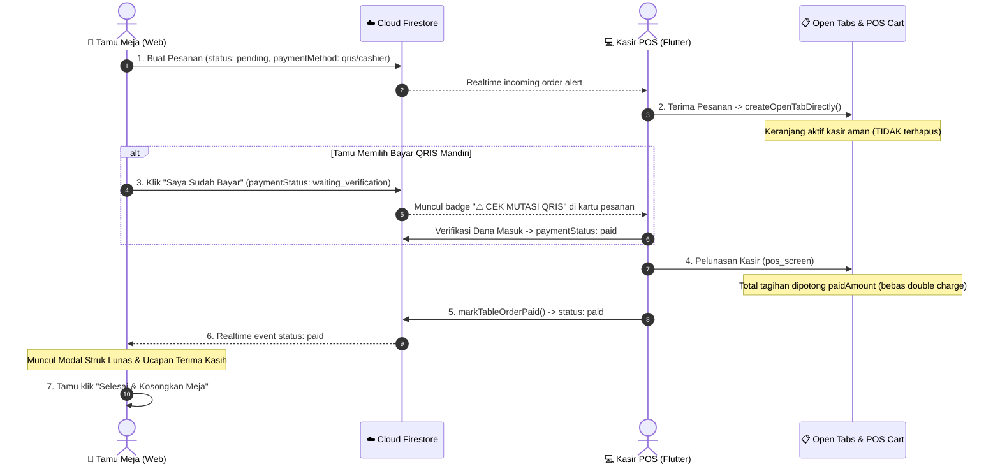

# Walkthrough: Analisis & Perbaikan Flow, UI, dan Logika Pembayaran Mini Resto POS

Dokumen ini mendokumentasikan hasil audit mendalam serta perbaikan arsitektural dan implementasi kode secara menyeluruh pada aplikasi kasir POS Flutter (`lib/`), website pemesanan mandiri meja (`web_order/`), dan aturan keamanan (`firestore.rules`).

---

## 1. Ringkasan Masalah Kritis yang Diselesaikan

| No | Komponen | Masalah Utama | Solusi & Hasil Perbaikan |
|---|---|---|---|
| 1 | Kasir (`OnlineOrderProvider`) | **Cart Collision**: Menekan "Terima & Buka Meja" online menghapus keranjang aktif kasir walk-in. | Dibuat `createOpenTabDirectly()` di `PosProvider`. Open tab dibuat murni dari item online tanpa menyentuh/menghapus keranjang kasir. |
| 2 | Kasir (`pos_screen`) | **Round 2 Double Charge**: Tagihan meja multi-ronde menagih ulang ronde 1 yang sudah dibayar di muka via QRIS. | Ditambahkan `paidAmount` & `onlineOrderId` pada `OrderModel`. Dialog checkout kasir memotong tagihan: `payableAmount = total - paidAmount`. |
| 3 | Kasir & Cloud | **Putusnya Sinkronisasi Pelunasan**: Kasir melunasi meja di POS, tapi Firestore tidak diupdate status `paid`. | `pos_screen.dart` memanggil `onlineOrderProvider.markTableOrderPaid(...)` ke Firestore saat checkout kasir selesai. |
| 4 | Web Meja (`app.js`) | **Ghost QRIS**: Tamu bayar via QRIS web tapi kasir tidak tahu apakah tamu sudah transfer atau belum. | Tamu klik "Saya Sudah Bayar" -> kirim `paymentStatus: 'waiting_verification'`. Kartu pesanan di kasir menampilkan badge kuning peringatan verifikasi mutasi. |
| 5 | Web Meja (`app.js`) | **Silent Disappearance**: Saat kasir menyelesaikan pesanan, layar HP tamu mendadak kembali ke menu awal tanpa struk. | Ditambahkan modal `paymentSuccessModal` lengkap dengan rincian lunas, total bayar, checkmark animasi, dan tombol *"Selesai & Kosongkan Meja"*. |
| 6 | Kasir (`open_tabs_screen`) | **Katalog Menu Terpotong**: Sinkronisasi menu cloud membaca list yang sedang difilter pencarian. | Diubah dari `posProvider.filteredProducts` menjadi `posProvider.products` (seluruh katalog). |
| 7 | Kasir (`open_tabs_screen`) | **Pencocokan Meja Kaku**: Meja berhuruf ("Lesehan A", "VIP 1") gagal dicocokkan dengan tab yang ada. | Diterapkan fungsi `_normalizeTable` yang mendukung normalisasi alfanumerik serta fallback digit. |
| 8 | Kasir (`products_screen`) | **Toggle Menu Habis Rusak**: Tombol habis/tersedia di kasir tidak membaca status aktual Firestore. | Provider kasir kini membaca `_cloudProductAvailability` realtime dua arah. |
| 9 | Web Meja (`app.js`) | **Pilihan Rasa Hilang saat Decrement**: Menekan tombol `-` di menu utama menghapus varian dengan custom note. | `updateQty` kini memprioritaskan pengurangan dari item tanpa catatan (`note == ""`). |
| 10 | Keamanan (`firestore.rules`) | **Celah Manipulasi Status Pesanan**: Tamu liar di konsol browser bisa memalsukan status pesanan menjadi `paid`. | Aturan diperketat: Tamu unauthenticated hanya boleh mengubah `paymentStatus: 'waiting_verification'`. Status `paid`/`completed` hanya boleh diubah kasir. |

---

## 2. Diagram Alur Transaksi & Sinkronisasi Realtime yang Baru

---

## 3. Daftar Berkas yang Dimodifikasi

### Lapisan Model & Layanan Kasir (Flutter)
- [`lib/models/online_order_model.dart`](file:///c:/Project/mini-resto-pos/lib/models/online_order_model.dart):
  - Field: `paymentMethod`, `paymentStatus`.
  - Getter: `isPaid`, `isQrisWaitingVerification`, `isQrisPaid`.
  - Serializer Firestore REST & Map.
- [`lib/models/order_model.dart`](file:///c:/Project/mini-resto-pos/lib/models/order_model.dart):
  - Field: `paidAmount`, `onlineOrderId`.
  - Getter: `remainingAmount`.
- [`lib/services/cloud_sync_service.dart`](file:///c:/Project/mini-resto-pos/lib/services/cloud_sync_service.dart):
  - Metode `markOrderAsPaid(orderId, paymentMethod)`.
  - Metode `updatePaymentStatus(orderId, paymentStatus)`.
- [`lib/providers/pos_provider.dart`](file:///c:/Project/mini-resto-pos/lib/providers/pos_provider.dart):
  - Metode `createOpenTabDirectly(...)`.
  - Normalisasi meja `_normalizeTable`.
  - Akumulasi `paidAmount` & `onlineOrderId` pada checkout.
- [`lib/providers/online_order_provider.dart`](file:///c:/Project/mini-resto-pos/lib/providers/online_order_provider.dart):
  - Integrasi `createOpenTabDirectly()` di `acceptOrder()`.
  - Metode `verifyQrisPayment(...)` & `markTableOrderPaid(...)`.
  - Sinkronisasi realtime `_cloudProductAvailability` & `isProductAvailable(...)`.

### Lapisan Antarmuka Kasir (Flutter)
- [`lib/views/screens/open_tabs_screen.dart`](file:///c:/Project/mini-resto-pos/lib/views/screens/open_tabs_screen.dart):
  - Badge visual status pembayaran QRIS mandiri dan tombol verifikasi instan.
  - Sinkronisasi menu menggunakan `posProvider.products`.
  - Pencocokan meja alfanumerik.
- [`lib/views/screens/pos_screen.dart`](file:///c:/Project/mini-resto-pos/lib/views/screens/pos_screen.dart):
  - Perhitungan tagihan bersih setelah uang muka (`paidAmount`).
  - Trigger otomatis pelunasan cloud via `markTableOrderPaid`.
- [`lib/views/screens/products_screen.dart`](file:///c:/Project/mini-resto-pos/lib/views/screens/products_screen.dart):
  - Tombol ketersediaan menu sinkron dua arah.

### Lapisan Web Pemesanan Mandiri (`web_order`)
- [`web_order/index.html`](file:///c:/Project/mini-resto-pos/web_order/index.html):
  - Struktur modal `#paymentSuccessModal`.
- [`web_order/styles.css`](file:///c:/Project/mini-resto-pos/web_order/styles.css):
  - Desain modern struk digital: animasi centang hijau, badge pembayaran, rincian menu.
- [`web_order/app.js`](file:///c:/Project/mini-resto-pos/web_order/app.js):
  - Konfirmasi QRIS mengirim status `waiting_verification`.
  - Penanganan status `paid` yang memicu `showPaymentSuccessReceipt()`.
  - Perbaikan prioritas decrement item di `updateQty()`.
  - Pembersihan otomatis sesi kadaluwarsa (> 4 jam) di `loadTableState()`.

### Lapisan Keamanan Cloud
- [`firestore.rules`](file:///c:/Project/mini-resto-pos/firestore.rules):
  - Pembatasan izin update tamu unauthenticated hanya untuk `paymentStatus: 'waiting_verification'`. Status akhir dan pembatalan diproteksi khusus kasir.

---

## 4. Panduan Verifikasi & Pengujian Lapangan

1. **Uji Perlindungan Keranjang Kasir**:
   - Masukkan menu ke keranjang kasir POS (jangan selesaikan transaksi).
   - Buat pesanan baru dari web meja `http://localhost:8080/?table=04`.
   - Di kasir, klik tab "Pesanan Online" -> klik "Terima & Buka Meja".
   - Kembali ke layar kasir utama -> Pastikan pesanan walk-in kasir sebelumnya tidak hilang.

2. **Uji Flow QRIS Mandiri & Verifikasi Kasir**:
   - Di web meja, pilih metode "QRIS", lalu klik "Saya Sudah Bayar".
   - Di kasir POS, amati kartu pesanan meja 04: akan muncul badge kuning `⚠️ CEK MUTASI QRIS (HP TAMU)`.
   - Kasir menekan tombol "Verifikasi Dana" -> status beralih menjadi `✅ QRIS LUNAS`.

3. **Uji Pelunasan & Tampilan Struk Digital di HP Tamu**:
   - Kasir melunasi meja 04 melalui POS.
   - Layar browser tamu otomatis menampilkan popup struk hijau dengan suara lonceng: *"Pembayaran Berhasil! Terima kasih telah berkunjung ke Resto Digital"*.
   - Tamu klik *"Selesai & Kosongkan Meja"* -> sesi meja bersih dan siap untuk tamu berikutnya.
